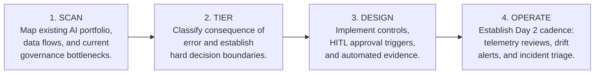

# Responsible AI Controls Architecture: From Principles to Day 2 Operations

[](LICENSE)
[]()
[]()
[](https://github.com/shibinantony)

> **A practical, executive framework for turning AI ethics, risk, and governance expectations into enforceable engineering controls, immutable audit evidence, and operational Day 2 routines.**

---

## Table of Contents

- [The Executive Problem: The Principle-to-Execution Gap](#the-executive-problem-the-principle-to-execution-gap)
- [The Five-Layer Controls Architecture](#the-five-layer-controls-architecture)
- [Controls Proportionality Matrix](#controls-proportionality-matrix)
- [Day 2 Operations & Telemetry Loop](#day-2-operations--telemetry-loop)
- [Maturity Progression Model](#maturity-progression-model)
- [Repository Contents & Deliverables](#repository-contents--deliverables)
- [The 4-Step Rollout Cadence](#the-4-step-rollout-cadence)
- [Related Repositories](#related-repositories)
- [License](#license)

---

## The Executive Problem: The Principle-to-Execution Gap

Over 80% of enterprises have published Responsible AI (RAI) Principles: *Fairness, Transparency, Accountability, Privacy, Security, and Human Oversight*. 

Yet when enterprise systems enter production or face regulatory inquiry, organizations stumble on four foundational gaps:
1. **Principles are stated, but controls are uneven:** Ethics charters do not specify API blocking gates, rate limits, or validation rules.
2. **Execution boundaries are blurry:** Teams fail to explicitly bound what the AI model is allowed to draft vs. recommend vs. autonomously execute.
3. **Evidence is paper-thin:** Governance sign-offs exist as static slide decks or meeting minutes rather than cryptographically verifiable runtime logs.
4. **Day 2 operational ownership is absent:** Models drift, third-party foundation models change silently, and prompt injection attacks adapt—without continuous monitoring to trigger remediation.

```mermaid
flowchart TD
    subgraph TraditionalFailure ["The Traditional Failure Mode"]
        P["High-Level Principles<br/>(Charters, PDFs, Ethics Boards)"]
        GAP["THE EXECUTION GAP<br/>(No enforcement boundary, no logs)"]
        PROD["Production AI Systems<br/>(Ad-hoc, unmonitored, fragile)"]
        P --> GAP
        GAP --> PROD
    end

    subgraph ControlledPipeline ["The Responsible AI Controls Architecture"]
        L1["1. Risk Classification<br/>(Consequence of error tiering)"]
        L2["2. Execution Boundary<br/>(Draft vs. Recommend vs. Execute)"]
        L3["3. Control Design<br/>(Guardrails, validation, HITL)"]
        L4["4. Evidence Capture<br/>(Prompt, sources, override, hashes)"]
        L5["5. Day 2 Monitoring<br/>(Drift, bypass, vendor shifts, incidents)"]

        L1 --> L2
        L2 --> L3
        L3 --> L4
        L4 --> L5
    end
```



> **The Director's Rule:**  
> *Responsible AI maturity is not proven by an ethics charter. It is proven by whether high-impact AI use cases have clear boundaries, enforceable controls, immutable evidence, and repeatable Day 2 routines.*

---

## The Five-Layer Controls Architecture

Each layer of the architecture converts strategic governance intent into a concrete engineering artifact:


| Layer | Executive Question | Control Output & Engineering Artifact |
|---|---|---|
| **01. Risk Classification** | *What happens if the AI is wrong?* | Use-case tiering based on customer, financial, legal, operational, reputational, and safety blast radius. |
| **02. Execution Boundary** | *What can AI decide, recommend, or trigger?* | Decision rights matrix, automation limits, mandatory human review paths, and escalation thresholds. |
| **03. Control Design** | *What prevents or detects misuse?* | Input guardrails, RAG grounding verification, sensitive data handling, schema validation, and output safety gates. |
| **04. Evidence Capture** | *Can we prove what happened later?* | Cryptographic audit ledger recording prompt, context, response, rationale, approvals, overrides, and replay logs. |
| **05. Day 2 Monitoring** | *How do we know controls keep working?* | Runtime telemetry for metric drift, output quality degradation, guardrail bypass alerts, vendor updates, and incidents. |

---

## Controls Proportionality Matrix

A low-impact internal summarization tool and an autonomous customer-facing financial or underwriting workflow should never carry the same control overhead:

| Risk Tier | Representative Use Cases | Required Control Posture |
|---|---|---|
| **High** | Customer claims, underwriting, credit decisioning, regulated financial advice | Mandatory human approval, causal explanations, cryptographic audit replay, continuous telemetry. |
| **Moderate** | Staff/adviser recommendation support, draft generation, customer triage | Grounding verification (RAG), review triggers, structured evidence capture. |
| **Low** | Internal employee productivity, knowledge search, code assist | Privacy filtering, quality checks, transparent user guidance. |

---

## Day 2 Operations & Telemetry Loop

Day 2 operations are where Responsible AI becomes real. Pre-launch approval is necessary; post-launch monitoring is what keeps controls alive amidst foundation model updates and shifting business data.


---

## Maturity Progression Model

Move your enterprise from passive ethical statements to autonomous, resilient governance:


---

## Repository Contents & Deliverables

This repository provides an integrated suite of director-level assets in both native Markdown and editable Microsoft Office formats:

```
responsible-ai-controls-architecture/
├── README.md                                             # Executive overview, architecture & navigation
├── LICENSE                                               # Apache 2.0 open-source license
├── .gitignore                                            # Git configuration
├── assets/                                               # Scalable Vector Graphics (SVG) diagrams
│   ├── 5-layer-controls-architecture.svg                 # The 5-layer model visual map
│   ├── day-2-monitoring-loop.svg                         # Runtime telemetry & trigger feedback loop
│   └── rai-maturity-model.svg                            # 4-stage enterprise maturity curve
└── docs/                                                 # Core deliverables & consulting instruments
    ├── 01-thought-leadership-article.md                  # Executive article (Markdown)
    ├── 01-thought-leadership-article.docx                # Executive article (Word)
    ├── 02-one-page-consulting-pov.md                     # One-page consulting POV (Markdown)
    ├── 02-one-page-consulting-pov.docx                   # One-page consulting POV (Word)
    ├── 03-five-slide-mini-deck.md                        # Board/Committee presentation (Markdown)
    ├── 03-five-slide-mini-deck.pptx                      # Board/Committee presentation (PowerPoint)
    ├── 04-enterprise-client-discovery-checklist.md       # Diagnostic assessment checklist (Markdown)
    └── 04-enterprise-client-discovery-checklist.docx     # Diagnostic assessment checklist (Word)
```

### Direct Document Links

1. [**01. Executive Thought Leadership Article**](docs/01-thought-leadership-article.md)  
   *Director-level article on moving RAI from philosophy to production controls. Ready for board packages, executive briefings, and LinkedIn publishing.*
2. [**02. One-Page Consulting Point of View (POV)**](docs/02-one-page-consulting-pov.md)  
   *A concise, high-impact consulting document articulating the business case, core thesis, and executive mandate for RAI controls.*
3. [**03. Executive 5-Slide Mini Deck**](docs/03-five-slide-mini-deck.md) *(Download [PowerPoint .pptx](docs/03-five-slide-mini-deck.pptx))*  
   *Boardroom-ready visual walkthrough: The Execution Gap, The 5-Layer Model, Proportionality Posture, Day 2 Operations, and The 4-Step Rollout.*
4. [**04. Enterprise Client Discovery Checklist**](docs/04-enterprise-client-discovery-checklist.md)  
   *A rigorous, 5-stage discovery instrument for assessing organizational AI maturity across scope, risk tiering, boundaries, controls, evidence, and Day 2 monitoring.*

---

## The 4-Step Rollout Cadence



1. **Scan (Weeks 1–2):** Inventory active and shadow AI use cases. Identify where teams are blocked by slow manual approvals.
2. **Tier (Weeks 3–4):** Apply the consequence-of-error scorecard. Establish explicit execution boundaries.
3. **Design (Weeks 5–8):** Deploy runtime policy gates, guardrails, and cryptographic evidence logging for the top 2 highest-impact workloads.
4. **Operate (Day 2+):** Transition to operational review: track bypass telemetry, evaluate vendor updates, and automate audit packaging.

---

## Related Repositories

Authored by **Shibin Antony** as part of an integrated enterprise AI governance suite:
- [**enterprise-ai-operating-model**](https://github.com/shibinantony/enterprise-ai-operating-model): The executive operating system, FinOps discipline, and TRACE transparency engine.
- [**agentguard-framework**](https://github.com/shibinantony/agentguard-framework): Vendor-neutral assurance control plane for AI agents (quality, safety, audit evidence).
- [**AIPOS-Framework**](https://github.com/shibinantony/AIPOS-Framework): AI Product Ownership System: charters, decision rights, and accountability.
- [**ai-governance-as-code**](https://github.com/shibinantony/ai-governance-as-code): Policy-as-Code and Governance-as-Code library for BFSI and Healthcare.
- [**agt-architecture-lab**](https://github.com/shibinantony/agt-architecture-lab): Independent architecture review and hands-on lab for Microsoft Agent Governance Toolkit.

---

## License

Licensed under the [Apache License, Version 2.0](LICENSE).  
Copyright © 2026 Shibin Antony. All rights reserved.
