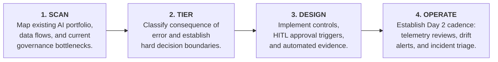

# Responsible AI Controls Architecture: From Principles to Day 2 Operations

[](LICENSE)
[]()
[]()
[](https://github.com/shibinantony)

> **A practical, executive model for turning AI ethics, risk, and governance expectations into enforceable engineering controls, immutable audit evidence, and operational Day 2 routines.**

---

## The Executive Problem: The Principle-to-Execution Gap

Over 80% of enterprises have published Responsible AI (RAI) Principles: *Fairness, Transparency, Accountability, Privacy, Security, and Human Oversight*. 

Yet when enterprise systems enter production or face regulatory inquiry, organizations stumble on four foundational gaps:
1. **Principles are stated, but controls are uneven:** Ethics principles do not specify API status codes, rate limits, or blocking gates.
2. **Execution boundaries are blurry:** Teams fail to explicitly bound what the AI model is allowed to draft vs. recommend vs. autonomously execute.
3. **Evidence is paper-thin:** Governance sign-offs exist as static PowerPoint decks or meeting minutes rather than cryptographically verifiable runtime logs.
4. **Day 2 operational ownership is absent:** Models drift, third-party foundation models change silently, and prompt injection attacks adapt—without continuous monitoring to trigger remediation.

**Responsible AI maturity is not proven by an ethics charter. It is proven by whether high-impact AI use cases have clear boundaries, enforceable controls, immutable evidence, and repeatable Day 2 routines.**

```mermaid
flowchart TD
    subgraph Gap ["The Traditional Failure Mode"]
        P["High-Level Principles<br/>(Charters, PDFs, Ethics Boards)"]
        GAP["❌ THE EXECUTION GAP<br/>(No enforcement boundary, no logs)"]
        PROD["Production AI Systems<br/>(Ad-hoc, unmonitored, fragile)"]
        P -.-> GAP -.-> PROD
    end

    subgraph Solution ["The Responsible AI Controls Architecture"]
        L1["1. Risk Classification<br/>(Consequence of error tiering)"]
        L2["2. Execution Boundary<br/>(Draft vs. Recommend vs. Execute)"]
        L3["3. Control Design<br/>(Guardrails, validation, HITL)"]
        L4["4. Evidence Capture<br/>(Prompt, sources, override, hashes)"]
        L5["5. Day 2 Monitoring<br/>(Drift, bypass, vendor shifts, incidents)"]

        L1 --> L2 --> L3 --> L4 --> L5
    end
```



---

## Architectural Pillars

### 1. The Five-Layer Controls Architecture

| Layer | Objective | Tangible Engineering Artifact |
|---|---|---|
| **01. Risk Classification** | Tier use cases strictly by the consequence of error, not technology hype. | System Tiering Scorecard (Low, Moderate, High consequence). |
| **02. Execution Boundary** | Explicitly define what the AI is permitted to decide, draft, trigger, or automate. | Decision Boundary Specification (e.g., Read-only vs. Human-approved action). |
| **03. Control Design** | Implement runtime controls, guardrails, schema validation, and escalation. | Policy-as-Code rules, input/output content safety filters, HITL workflows. |
| **04. Evidence Capture** | Capture verifiable, audit-ready records of model behavior and human oversight. | Immutable Evidence Ledger (Prompt, context, model version, human override). |
| **05. Day 2 Monitoring** | Ensure controls survive live operation, model updates, and data shifts. | Drift alarms, guardrail bypass alerts, incident response runbooks. |

---

### 2. Proportionality: Matching Burden to Consequence of Error

A low-impact internal summarization tool and an autonomous claims adjudication agent must never carry the same control overhead:

```
┌────────────────────────────────────────────────────────────────────────┐
│ HIGH RISK: Customer, claims, underwriting, clinical, regulated advice │
│ → Mandatory human sign-off, causal explanations, full audit replay    │
├────────────────────────────────────────────────────────────────────────┤
│ MODERATE RISK: Staff / adviser recommendation support                  │
│ → Grounding verification (RAG), review triggers, evidence logging      │
├────────────────────────────────────────────────────────────────────────┤
│ LOW RISK: Internal employee productivity, knowledge search, code assist│
│ → Privacy filtering, basic safety checks, transparent user guidance   │
└────────────────────────────────────────────────────────────────────────┘
```

---

## Included Artifacts & Deliverables

This repository packages a complete consulting and enterprise transformation toolkit:

* [**01. Executive Thought Leadership Article**](docs/01-thought-leadership-article.md)  
  *Director-level article on moving RAI from philosophy to production controls. Ready for board packages, executive briefings, and LinkedIn publishing.*
* [**02. One-Page Consulting Point of View (POV)**](docs/02-one-page-consulting-pov.md)  
  *A concise, high-impact consulting document articulating the business case, core thesis, and executive mandate for RAI controls.*
* [**03. Executive 5-Slide Mini Deck**](docs/03-five-slide-mini-deck.md) *(also available in [PowerPoint `.pptx`](docs/03-five-slide-mini-deck.pptx))*  
  *Boardroom-ready visual walkthrough: The Execution Gap, The 5-Layer Model, Proportionality Posture, Day 2 Operations, and The 4-Step Rollout.*
* [**04. Enterprise Client Discovery Checklist**](docs/04-enterprise-client-discovery-checklist.md)  
  *A rigorous, 5-stage discovery instrument for assessing organizational AI maturity across scope, risk tiering, boundaries, controls, evidence, and Day 2 monitoring.*

---

## The 4-Step Rollout Cadence



1. **Scan (Week 1–2):** Inventory active and shadow AI use cases. Identify where teams are blocked by slow manual approvals.
2. **Tier (Week 3–4):** Apply the consequence-of-error scorecard. Establish explicit execution boundaries.
3. **Design (Week 5–8):** Deploy runtime policy gates, guardrails, and cryptographic evidence logging for the top 2 highest-impact workloads.
4. **Operate (Day 2+):** Transition to operational review: track bypass telemetry, evaluate vendor updates, and automate audit packaging.

---

## Enterprise AI Portfolio Ecosystem

Authored by **Shibin Antony** as part of an integrated enterprise AI governance suite:
- [**enterprise-ai-operating-model**](https://github.com/shibinantony/enterprise-ai-operating-model): The executive operating system, FinOps discipline, and TRACE transparency engine.
- [**agentguard-framework**](https://github.com/shibinantony/agentguard-framework): Vendor-neutral assurance control plane for AI agents (quality, safety, audit evidence).
- [**AIPOS-Framework**](https://github.com/shibinantony/AIPOS-Framework): AI Product Ownership System: charters, decision rights, and accountability.
- [**ai-governance-as-code**](https://github.com/shibinantony/ai-governance-as-code): Policy-as-Code and Governance-as-Code library for BFSI and Healthcare.
- [**agt-architecture-lab**](https://github.com/shibinantony/agt-architecture-lab): Independent architecture review and hands-on lab for Microsoft Agent Governance Toolkit.

---

## License

Licensed under the [Apache License, Version 2.0](LICENSE).  
Copyright © 2026 Shibin Antony. All rights reserved.
