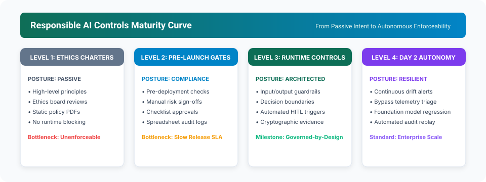

# One-Page Consulting Point of View: Responsible AI Controls Architecture

> **Navigation:** [🏠 Overview](../README.md) | [📰 01. Thought Leadership](01-thought-leadership-article.md) | **📄 02. Consulting POV** | [📊 03. Mini Deck](03-five-slide-mini-deck.md) | [📋 04. Discovery Checklist](04-enterprise-client-discovery-checklist.md)

---

## Executive Summary & Core Thesis

> **Core Thesis:**  
> Responsible AI maturity is not proven by ethical principles alone. It is proven by whether high-impact AI use cases have **clear boundaries, enforceable controls, immutable evidence, distinct ownership, continuous monitoring, and repeatable Day 2 operational routines**.

---

## Why This Matters

Boards of Directors, Risk Committees, and Regulators increasingly expect enterprises to demonstrate how AI risks are governed **in practice**, not in theory. 

For regulated enterprises, the critical gap is rarely intent—it is **execution**:
* Corporate policies describe *what should ideally happen*.
* Engineering teams need runtime controls that define *what the AI is authorized to do*, *when humans must intervene*, *what evidence is captured*, and *how drift and incidents are monitored post-deployment*.

---

## The Five-Layer Controls Architecture

Each layer of the architecture converts strategic governance intent into a concrete engineering artifact:

| Layer | Executive Question | Control Output & Engineering Artifact |
|---|---|---|
| **01. Risk Classification** | *What happens if the AI is wrong?* | Use-case tiering based on customer, financial, legal, operational, reputational, and safety consequence of error. |
| **02. Execution Boundary** | *What can AI decide, recommend, or trigger?* | Decision rights matrix, automation limits, mandatory human review paths, and escalation thresholds. |
| **03. Control Design** | *What prevents or detects misuse?* | Input guardrails, RAG grounding verification, sensitive data handling, schema validation, and output safety gates. |
| **04. Evidence Capture** | *Can we prove what happened later?* | Cryptographic audit ledger recording prompt, context, response, rationale, approvals, overrides, and replay logs. |
| **05. Day 2 Monitoring** | *How do we know controls keep working?* | Runtime telemetry for metric drift, output quality degradation, guardrail bypass alerts, vendor updates, and incidents. |

---

## Maturity Progression: From Charters to Autonomous Governance

---

## What This Architecture Enables

1. **Faster AI Adoption Velocity:** Risk, boundary, and control expectations are defined *before* build or deployment, eliminating multi-month governance review backlogs.
2. **Audit-Ready Evidence by Design:** System decisions, human sign-offs, exceptions, and monitoring alerts are captured automatically as a by-product of runtime execution.
3. **Cross-Functional Accountability:** AI ownership is clearly delineated across Business Product Owners, Risk, Legal, Engineering, Security, and Data teams.
4. **Resilient Day 2 Operations:** AI workloads are continuously monitored in production, ensuring safeguards adapt when underlying foundation models or user behaviors change.

---

## Enterprise Advisory Offer: 4-to-6 Week Control Sprint

| Phase | Strategic Focus | Deliverable & Tangible Output |
|---|---|---|
| **Phase 1: Current-State Scan** (Weeks 1–2) | Inventory use cases, map approval workflows, identify evidence gaps, and isolate approval bottlenecks. | **AI Controls Heatmap** & prioritized high-impact scope. |
| **Phase 2: Control Architecture** (Weeks 3–4) | Define consequence-of-error tiering, human decision boundaries, Policy-as-Code templates, and evidence schemas. | **Responsible AI Control Blueprint** customized by use-case risk tier. |
| **Phase 3: Operating Model & Day 2** (Weeks 5–6) | Assign owners, define incident runbooks, configure telemetry thresholds, and establish Day 2 review cadences. | **Repeatable Governance & Day 2 Operations Playbook**. |

---

## Next Steps & Reading Path

* **Previous Document:** [01. Thought Leadership Article](01-thought-leadership-article.md)
* **Present to the Board:** [03. Executive 5-Slide Mini Deck](03-five-slide-mini-deck.md)
* **Assess Your Organization:** [04. Enterprise Client Discovery Checklist](04-enterprise-client-discovery-checklist.md)
* **Return to Main Overview:** [Repository README](../README.md)