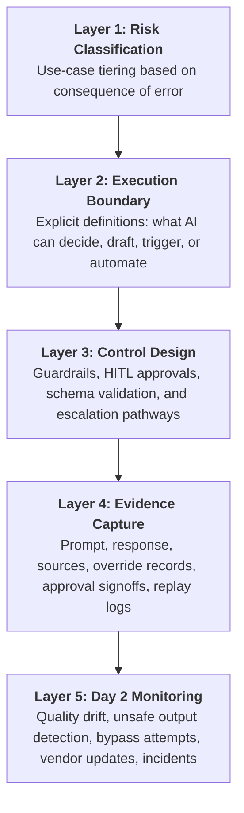
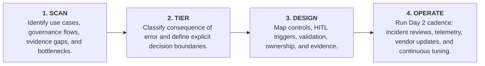

# Responsible AI Controls Architecture: 5-Slide Mini Deck

> **Executive Deck:** Operationalizing Responsible AI from Principles to Controls  
> **Format:** CXO Board / Committee Presentation  
> **Original Slides:** Available as PowerPoint in [`03-five-slide-mini-deck.pptx`](03-five-slide-mini-deck.pptx)

---

## Slide 1: The Execution Gap

### CXO POINT OF VIEW
**Responsible AI must move from principles to controls.**  
A practical model for turning AI ethics, risk, and governance expectations into enforceable controls, evidence, monitoring, and operating routines.

```
┌────────────────────────────────────────────────────────┐
│                   THE EXECUTION GAP                    │
├────────────────────────────────────────────────────────┤
│  • Principles are stated.                              │
│  • Controls are uneven.                                │
│  • Evidence is thin.                                   │
│  • Day 2 ownership is unclear.                         │
└────────────────────────────────────────────────────────┘
```

*Key Takeaway:* Most enterprises possess an AI Ethics Charter. Very few possess the runtime controls, evidence ledgers, and operational ownership required to prove compliance when an incident or regulatory audit occurs.

---

## Slide 2: The Five-Layer Controls Architecture

### RESPONSIBLE AI CONTROLS ARCHITECTURE
**The five-layer model makes Responsible AI executable.**  
Each layer converts strategic intent into a specific engineering and governance artifact.



---

## Slide 3: Proportionality by Consequence of Error

### PROPORTIONAL CONTROLS POSTURE
**Controls must be proportional to the consequence of error.**  
A low-impact internal productivity tool and an autonomous customer-facing financial or medical workflow should never carry the same control burden.

| Risk Tier | Representative Use Cases | Required Control Posture |
|---|---|---|
| **Low** | Internal summarization, developer assistance, search | Privacy filtering, quality checks, transparent user guidance. |
| **Moderate** | Staff/adviser recommendation support, draft generation | Knowledge grounding (RAG), review triggers, structured evidence capture. |
| **High** | Customer-facing claims, underwriting, credit, regulated advice | Mandatory human approval, causal explanations, audit replay ledger, continuous telemetry. |

---

## Slide 4: Day 2 Operational Reality

### APPROVAL VS. CONTINUOUS OPERATIONS
**Day 2 operations are where Responsible AI becomes real.**  
Pre-launch sign-off is necessary; post-launch monitoring is what keeps controls alive amidst model updates and shifting data.

```mermaid
flowchart LR
    subgraph ControlsRun ["Controls That Run"]
        C1["Runtime Guardrails"]
        C2["Human-in-the-Loop Triggers"]
        C3["Cryptographic Evidence Capture"]
        C4["Exception Handling"]
        C5["Control Telemetry"]
    end

    subgraph TriggerSignals ["Signals Triggering Action"]
        S1["Quality & Metric Drift"]
        S2["Unsafe Output / Hallucination"]
        S3["Control Bypass Attempts"]
        S4["Upstream Model/Vendor Changes"]
        S5["Operational Incidents"]
    end

    ControlsRun <-->|"Continuous Feedback Loop"| TriggerSignals
```



---

## Slide 5: The 4-Step Implementation Cadence

### START FOCUSED, SCALE SYSTEMATICALLY
**Start with one high-impact use case and prove the operating model.**  
The fastest path to enterprise maturity is not multi-year theoretical abstraction—it is a focused control sprint producing validated evidence.



> **The Director's Rule:** *Responsible AI becomes credible only when it can be enforced, monitored, and evidenced.*
