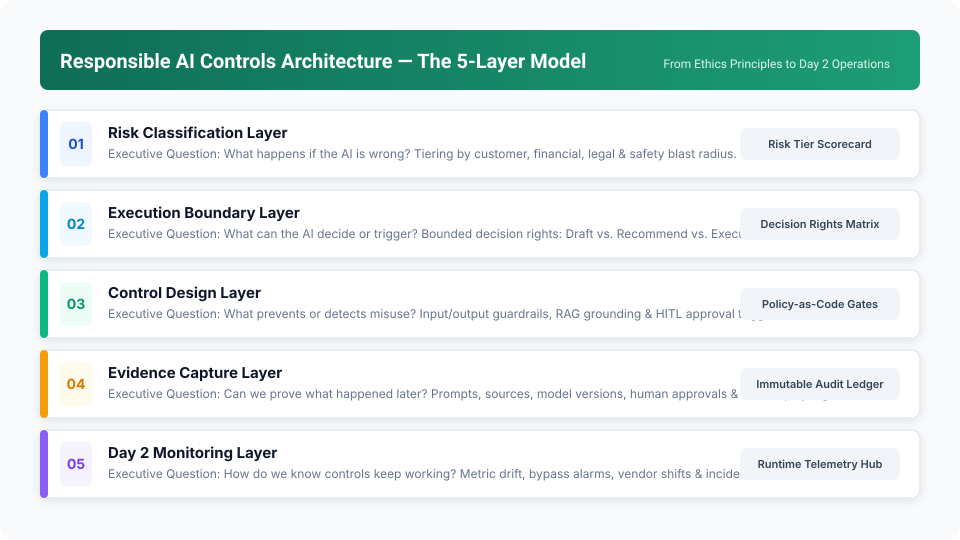
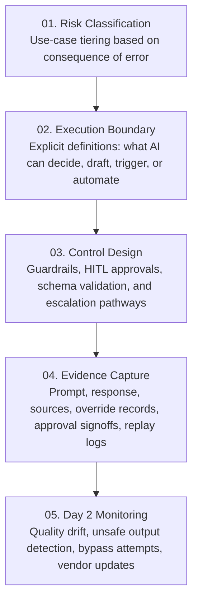
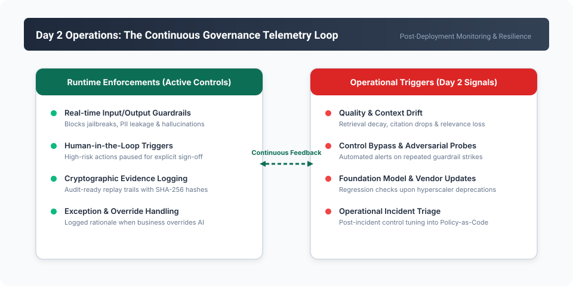
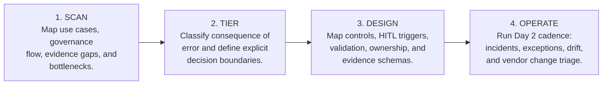

# Responsible AI Controls Architecture: 5-Slide Mini Deck

> **Navigation:** [🏠 Overview](../README.md) | [📰 01. Thought Leadership](01-thought-leadership-article.md) | [📄 02. Consulting POV](02-one-page-consulting-pov.md) | **📊 03. Mini Deck** | [📋 04. Discovery Checklist](04-enterprise-client-discovery-checklist.md)  
> **Source Asset:** [📥 Download 03-five-slide-mini-deck.pptx](03-five-slide-mini-deck.pptx)

---

## Slide 1: The Execution Gap

### CXO Point of View
**Responsible AI must move from principles to controls.**  
A practical model for turning AI ethics, risk, and governance expectations into enforceable controls, immutable evidence, continuous monitoring, and operating routines.

```
┌────────────────────────────────────────────────────────┐
│                   THE EXECUTION GAP                    │
├────────────────────────────────────────────────────────┤
│  • Principles are stated.                              │
│  • Controls are uneven.                                │
│  • Evidence is thin.                                   │
│  • Day 2 ownership is unclear.                         │
└────────────────────────────────────────────────────────┘
```

> **The Executive Insight:**  
> Most enterprises possess an AI Ethics Charter. Very few possess the runtime controls, immutable evidence ledgers, and operational ownership required to satisfy regulators and boards when an incident or audit occurs.

---

## Slide 2: The Five-Layer Controls Architecture

### Making Responsible AI Executable
Each layer converts strategic policy intent into a tangible engineering artifact.





---

## Slide 3: Proportionality by Consequence of Error

### Controls Proportional to Consequence of Error
A low-impact internal productivity assistant and an autonomous customer-facing financial or underwriting workflow should never carry the same control overhead.

| Risk Tier | Representative Use Cases | Control Posture & Requirements |
|---|---|---|
| **Low** | Internal summarization, employee search, coding assistance | Privacy filtering, quality checks, transparent user guidance. |
| **Moderate** | Staff/adviser recommendation support, draft generation | Grounding verification (RAG), review triggers, structured evidence capture. |
| **High** | Customer-facing claims, underwriting, credit, clinical advice | Mandatory human approval, causal explanations, audit replay ledger, continuous telemetry. |

---

## Slide 4: Day 2 Operational Reality

### Approval Before Launch vs. Monitoring After Launch
Day 2 operations are where Responsible AI becomes real. Pre-launch approval is necessary; post-launch monitoring is what keeps controls alive amidst model updates and shifting data.



---

## Slide 5: The 4-Step Implementation Cadence

### Start Focused, Scale Systematically
Start with one or two high-impact use cases and prove the operating model. The fastest path to enterprise maturity is not multi-year theoretical abstraction—it is a focused control sprint producing validated evidence.



> **The Director's Rule:**  
> *Responsible AI becomes credible only when it can be **enforced, monitored, and evidenced**.*

---

## Next Steps & Reading Path

* **Previous Document:** [02. One-Page Consulting Point of View](02-one-page-consulting-pov.md)
* **Conduct a Diagnostic:** [04. Enterprise Client Discovery Checklist](04-enterprise-client-discovery-checklist.md)
* **Read Thought Leadership:** [01. Thought Leadership Article](01-thought-leadership-article.md)
* **Return to Main Overview:** [Repository README](../README.md)
